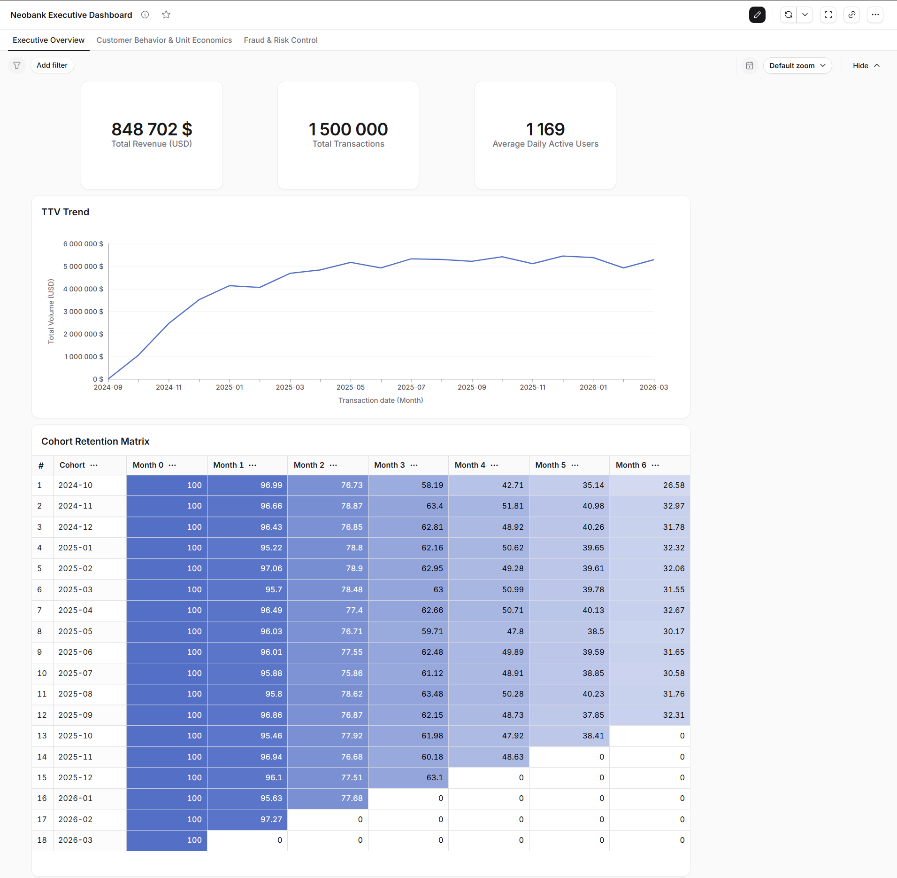
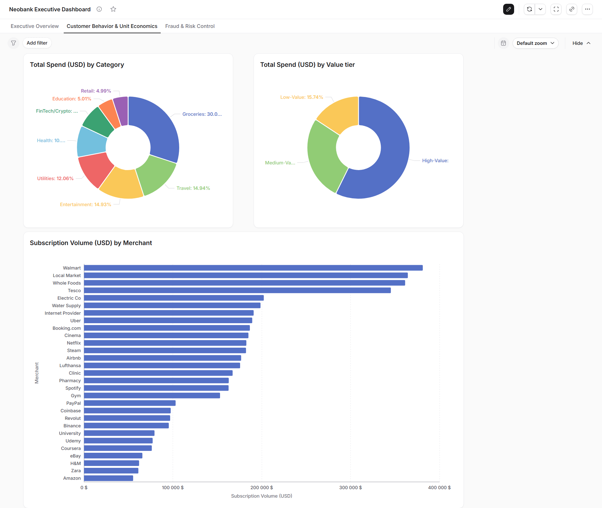
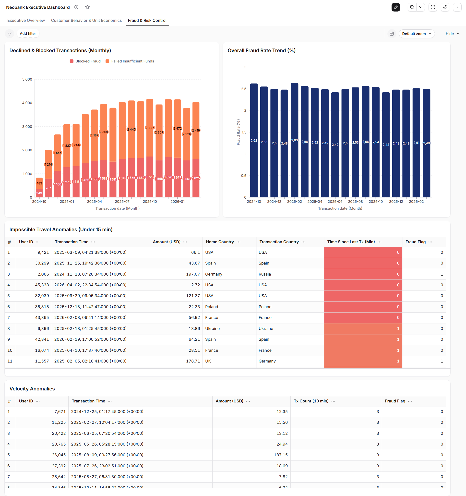
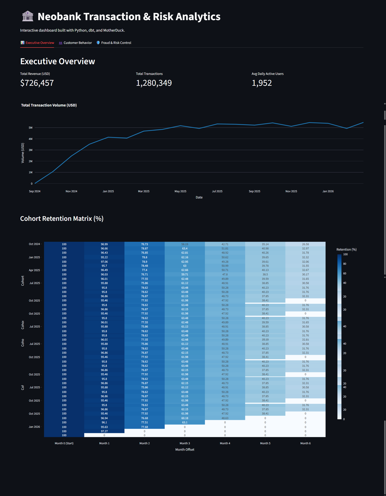
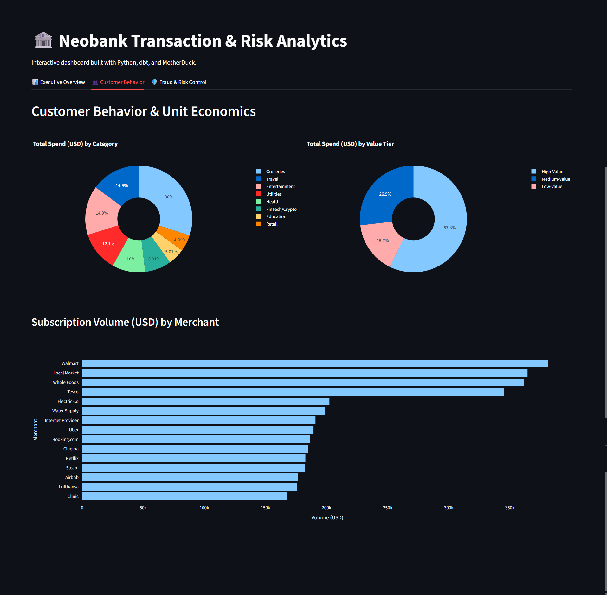
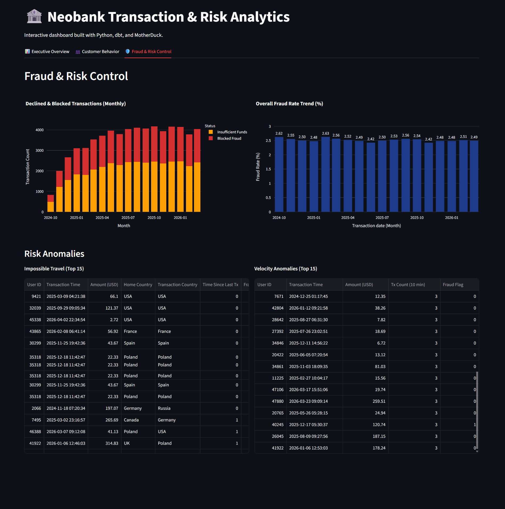

# 🏦 Neobank Transaction & Risk Analytics

This is a personal data engineering & analytics project where I built an end-to-end pipeline for a fictional neobank. My goal was to simulate real-world data architecture, starting from raw Python data generation to building a governed metrics layer and interactive dashboards.

## 💡 Why I built this
Neobanks process millions of transactions. The business questions I wanted to answer with this data were:
1. **Executive:** How is our transaction volume (TTV) and revenue growing month over month?
2. **Product:** Which customer segments drive the most value, and how well do we retain them (Cohort Analysis)?
3. **Risk:** How do we catch fraud patterns like "Impossible Travel" or "Velocity" before the money leaves the bank?

## 🛠️ The Stack & Architecture
I intentionally chose a modern "Data-as-Code" stack:

*   **Data Generation:** Python (`Faker`, `NumPy`). I generated 50,000 users and 1.5M transactions.
*   **Warehouse:** **MotherDuck** (Cloud DuckDB). It's lightweight, fast, and perfectly suited for analytical queries.
*   **Transformation:** **dbt (Data Build Tool)**. I built a proper Staging -> Marts architecture (Star Schema). All business metrics are defined in `schema.yml` using the *Metrics-as-Code* approach.
*   **BI Layer:** **Lightdash**. Because it connects directly to dbt, ensuring a single source of truth for all metrics.
*   **Data App:** **Streamlit**. I used this to build a fully interactive Python dashboard, avoiding the UI bugs of self-hosted Lightdash.

## 🚀 Production-Grade Features (Senior Level)
This project goes beyond basic analytics and includes production-ready engineering practices:

1. **CI/CD Data Quality Gates (GitHub Actions):** Every push triggers an automated dbt build and test pipeline on a dedicated CI database (`neobank_ci`). Bad data (duplicates, nulls) is blocked from reaching production.
2. **Machine Learning Fraud Detection:** A Random Forest classifier (`scikit-learn`) predicts the probability of fraud for each transaction. The model is integrated into the Streamlit app with an interactive threshold slider to simulate the trade-off between catching fraud and false positives.
3. **Automated Orchestration:** A scheduled GitHub Actions workflow (`daily_pipeline.yml`) runs the entire dbt pipeline automatically every night at 02:00 UTC, simulating a real production environment.
  

## 📂 Project Structure
```text
neobank-analytics/
│
├── assets/                 # Screenshots for README
├── data/                   # Raw CSVs and processed DB files (ignored in git)
├── dbt_project/            # dbt project
│   ├── models/
│   │   ├── staging/        # Cleaning and standardizing raw data
│   │   └── marts/          # Fact tables, dimensions, and metrics
│   ├── dbt_project.yml     # dbt configuration
│   └── profiles.yml        # dbt connection settings
├── lightdash/              # Docker configuration for the Lightdash BI server
├── scripts/                # Python scripts
│   ├── generate_users.py   # Synthetic user generation
│   ├── generate_transactions.py # Transaction generation (with churn logic)
│   └── load_to_duckdb.py   # Loading script to MotherDuck
├── streamlit_app/          # Streamlit Data App
│   └── app.py              # Main interactive dashboard code
├── .gitignore
├── README.md
└── requirements.txt
```

## 🧠 Real Engineering Challenges I Solved
Building this wasn't just writing `SELECT *`. I ran into realistic data problems and fixed them in code:

1.  **Synthetic Data Churn:** My initial Python script made every user active for all 18 months (100% retention). I rewrote the logic to use **exponential decay** for user lifespans, so the cohort retention curves now look realistic.
2.  **The "Future Date" Bug:** Because of the churn logic, some users were generating transactions in 2027. I had to implement strict date filters (`WHERE transaction_at <= '2026-03-31'`) in the dbt models to clean the data.
3.  **Fraud Rate Mathematics:** I noticed Lightdash was averaging daily fraud percentages, causing massive spikes (e.g., 4.25%) due to low daily transaction volumes. I fixed the SQL to calculate the **weighted average** (Total Fraud / Total Transactions) directly in dbt.
4.  **Card Testing Anomalies:** To make the Velocity analysis work, I implemented SQL Window Functions (`RANGE BETWEEN INTERVAL '10 minutes' PRECEDING`) to flag users making multiple transactions within 10 minutes.

## 📊 Key Business Insights
Here is what the data actually showed:

*   **The Pareto Principle is alive:** The top 33% of customers (`High-Value` tier) generated **57% of the total spending**, while the bottom 33% generated only 15%. 
*   **Retention:** After a sharp drop in Month 1, the retention curve flattens out around 30-40% by Month 6. This means users who survive the first month tend to stay with the bank long-term.
*   **Fraud Rate:** The fraud rate sits steadily around **2.5%**. However, by analyzing "Impossible Travel" (transactions in different countries within minutes), I was able to flag specific high-risk anomalies for the risk team to investigate.

## 🚀 Live Demo & Dashboards
*(Note: The Streamlit app is deployed live! Click the link below)*
👉 **[Live Streamlit App](https://neobank-analytics.streamlit.app/)**

### Lightdash (Metrics-as-Code)




### Streamlit (Python Data App)



